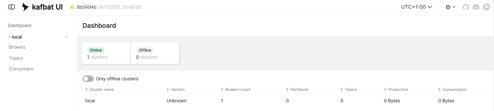

# Exercise 5: Part 0 - Setup

The three images (PostgreSQL, Kafka, Kafka UI) are **~1.2 GB** together.
Please download them beforehand:

```bash
docker compose pull
docker compose up -d
```

Then check that:

1. `docker ps` shows three running containers: `postgres`, `kafka` and
   `kafka-ui`.

| Container ID | Image | Names |
|------|------|------|
| b501eeecfe43 | ghcr.io/kafbat/kafka-ui:v1.3.0 | kafka-ui |
| 66a6bcd0d8c9 | postgres:18.1 | postgres |
| 89dfc92e9195 | apache/kafka:4.1.1 | kafka |


2. <http://localhost:8080> opens the Kafka UI.


Prepare a Python virtual environment in this folder (on Windows use `python`
or `py` instead of `python3`, and `venv\Scripts\activate` instead of
`source venv/bin/activate`):

```bash
python -m venv venv
venv\Scripts\activate
pip install --upgrade pip
pip install -r requirements.txt
```

```
pip list
Package         Version
--------------- -------
confluent-kafka 2.15.1
pip             26.3
psycopg         3.3.6
psycopg-binary  3.3.6
tzdata          2026.6
```

All Python commands below assume this environment is active.

> **Containers from earlier exercises** use the same ports (e.g. 5432).
> Stop them first: `docker compose down` in their folder.

```bash
docker compose down
```