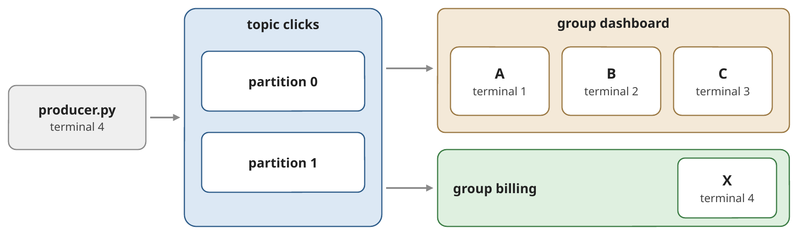

# Exercise 5: Part 1 - Kafka quick start (not graded)

Four steps, one idea each; Part 2 builds on all four. In every step,
**predict** first, then run the commands, then check.

Open a terminal in `clients/` with the virtual environment active. The
broker runs at `localhost:9092`. The Kafka command-line tools run inside the
`kafka` container (`docker exec -it kafka …`); the Kafka UI
(<http://localhost:8080>) shows the same information in the browser.

### 1. A topic is a set of logs
Created topic clicks:
```bash
docker exec -it kafka kafka-topics.sh --bootstrap-server localhost:9092 \
--create --topic clicks --partitions 2 --replication-factor 1

docker exec -it kafka kafka-topics.sh --bootstrap-server localhost:9092 \
--describe --topic clicks
```

The topic `clicks` has two **partitions**: two append-only logs in which
every new event gets the next **offset** (0, 1, 2, …). Partitions are the
unit of parallelism. (`--replication-factor 1`: one copy of each
partition, because we have a single broker.) Kafka keeps events for 7 days
by default (`retention.ms`), whether anybody read them or not.

### 2. Keys decide the partition

`producer.py` sends 20 click events with the keys `user-1` … `user-4` and
prints the partition and offset of each event.

*Predict:* run it twice. Does `user-1` land in the same partition both
times? Where do events without a key go?

```bash
python producer.py
python producer.py
python producer.py --no-key
```

Answer:


| Run 1 | Run 2 | Run 3 (no key) |
|------|------|------|
| key=user-1    ->  partition 0  offset 0 | key=user-1    ->  partition 0  offset 11 | key=None      ->  partition 1  offset 18 |
| key=user-3    ->  partition 1  offset 0 | key=user-3    ->  partition 1  offset 9 | key=None      ->  partition 0  offset 22 |
| key=user-2    ->  partition 0  offset 1 | key=user-2    ->  partition 0  offset 12 | key=None      ->  partition 0  offset 23 |
| key=user-1    ->  partition 0  offset 2 | key=user-1    ->  partition 0  offset 13 | key=None      ->  partition 0  offset 24 |
| key=user-1    ->  partition 0  offset 3 | key=user-1    ->  partition 0  offset 14 | key=None      ->  partition 1  offset 19 |
| key=user-4    ->  partition 1  offset 1 | key=user-4    ->  partition 1  offset 10 | key=None      ->  partition 1  offset 20 |
| key=user-1    ->  partition 0  offset 4 | key=user-1    ->  partition 0  offset 15 | key=None      ->  partition 1  offset 21 |
| key=user-2    ->  partition 0  offset 5 | key=user-2    ->  partition 0  offset 16 | key=None      ->  partition 1  offset 22 |
| key=user-1    ->  partition 0  offset 6 | key=user-1    ->  partition 0  offset 17 | key=None      ->  partition 0  offset 25 |
| key=user-2    ->  partition 0  offset 7 | key=user-2    ->  partition 0  offset 18 | key=None      ->  partition 0  offset 26 |
| key=user-4    ->  partition 1  offset 2 | key=user-4    ->  partition 1  offset 11 | key=None      ->  partition 1  offset 23 |
| key=user-4    ->  partition 1  offset 3 | key=user-4    ->  partition 1  offset 12 | key=None      ->  partition 0  offset 27 |
| key=user-3    ->  partition 1  offset 4 | key=user-3    ->  partition 1  offset 13 | key=None      ->  partition 0  offset 28 |
| key=user-2    ->  partition 0  offset 8 | key=user-2    ->  partition 0  offset 19 | key=None      ->  partition 0  offset 29 |
| key=user-4    ->  partition 1  offset 5 | key=user-4    ->  partition 1  offset 14 | key=None      ->  partition 1  offset 24 |
| key=user-3    ->  partition 1  offset 6 | key=user-3    ->  partition 1  offset 15 | key=None      ->  partition 0  offset 30 |
| key=user-2    ->  partition 0  offset 9 | key=user-2    ->  partition 0  offset 20 | key=None      ->  partition 0  offset 31 |
| key=user-1    ->  partition 0  offset 10 | key=user-1    ->  partition 0  offset 21 | key=None      ->  partition 1  offset 25 |
| key=user-4    ->  partition 1  offset 7 | key=user-4    ->  partition 1  offset 16 | key=None      ->  partition 0  offset 32 |
| key=user-3    ->  partition 1  offset 8 | key=user-3    ->  partition 1  offset 17 | key=None      ->  partition 1  offset 26 |


> **Same key → same partition → same order.** The partition is
> `hash(key) mod number of partitions`, on every run. Events without a key
> are spread over both partitions: the order per user is lost.

### 3. Consumer groups share the work

`consumer.py` joins a consumer group and prints the partitions it gets and
every event it reads. Keep your terminal for the producer and open three
more in `clients/` (virtual environment active). Start `A`, `B` and `C`
one after the other; wait each time until the new consumer prints its
partitions.

*Predict:* three consumers, two partitions. Who gets what?

```bash
python3 consumer.py --group dashboard --name A
python3 consumer.py --group dashboard --name B
python3 consumer.py --group dashboard --name C
```



Send events (`python3 producer.py`): who reads which keys? Then start a
consumer of a **second** group in the producer's terminal:
`python3 consumer.py --group billing --name X`. Which events does `X` read?

> **Within a group, one partition → one consumer.** `C` stays idle: more
> consumers than partitions do not help. Every join or leave triggers a
> **rebalance**, and a partition can move to another consumer. Another
> group (`X`) reads all events on its own, without changing `dashboard`.

### 4. Offsets: where a group continues

Stop all consumers (`Ctrl+C`). *Predict:* you send 20 more events. Where
does `dashboard` continue when `A` comes back?

```bash
python3 producer.py

docker exec -it kafka kafka-consumer-groups.sh --bootstrap-server localhost:9092 \
  --describe --group dashboard
```

Per partition: `CURRENT-OFFSET` (where the group is), `LOG-END-OFFSET` (the
end of the log) and `LAG` (the difference). Start `A` again and check your
prediction. Then replay the whole topic for `billing`, and start `X` again:

```bash
docker exec -it kafka kafka-consumer-groups.sh --bootstrap-server localhost:9092 \
  --group billing --topic clicks --reset-offsets --to-earliest --execute
```

> **The committed offset is the group's position in the log, stored in
> Kafka.** A consumer continues where its group stopped; the lag says how
> far behind it is. Reading deletes nothing: a reset (or a new group) reads
> the history again, e.g. to fill a new service or to reprocess after a bug
> fix, without affecting other groups.

### What you take into Part 2

| You saw | In Part 2 it decides |
|---|---|
| key → partition | whether all readings of a machine reach the same detector, in order |
| one consumer per partition | how many detector instances can work in parallel |
| independent groups | whether an archive or a dashboard can read without disturbing the detector |
| offsets and lag | whether the detector keeps up, and where it starts reading |


