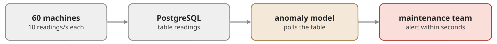

# Exercise 5: Part 2 - *Line Guardian*: predictive maintenance (graded)

**Scenario.** A manufacturer runs CNC machine tools (Computer Numerical
Control: computer-controlled milling machines and lathes) and
injection-moulding machines.
When a spindle bearing fails, the line stands still for a shift. The data
science team has trained a model that recognises bearing wear in the
vibration signal tens of seconds before it becomes critical. The
maintenance team wants an alert (an anomaly event) within seconds, so that
a technician can stop the machine before the bearing breaks.

The lab plant has 60 machines that send a reading 10 times per second
(600 readings/s). The group rolls the system out to 2,000 machines at 50 Hz
(100,000 readings/s). Today the gateways write every reading into
PostgreSQL, and a detector polls the table. **Your job:** find out whether
and why that is not good enough, decide on a better architecture, and, as
an optional challenge, build it.



Everything is in the folder `guardian/`:

| File | What | Change it? |
|---|---|---|
| `plant.py` | the machines and their gateways; injects bearing faults | only the class marked `TODO` (Stage C) |
| `model.py` | the data science team's model | no |
| `services.py` | the connection to PostgreSQL, the plant's system of record (machine registry) | no |
| `baseline_detector.py` | today's detector: polls PostgreSQL | no |
| `detector_service.py` | a new detector service (skeleton) | **yours** |
| `scoreboard.py` | scores a run against the ground truth | no |

Read the description at the top of `model.py` first: the model is
**stateful per machine**, and it has an inference cost per reading.

**Requirements**

| | Requirement |
|---|---|
| R1 | **Scale:** 600 readings/s in the lab; the design must grow to 100,000 readings/s. |
| R2 | **Complete and ordered:** the model gets *every* reading of a machine, in `seq` order (the model counts `missing` and `out-of-order` readings). |
| R3 | **Fresh:** anomalies at most 5 s (p95) after the reading, at full rate. |
| R4 | **Independent consumers:** the raw readings also feed a training-data archive and a live dashboard. Adding a consumer must not slow down, change or break the others, and must not add load to PostgreSQL. |

Do not change the files marked "no", and do not read `ground_truth.jsonl`
in your code (in real life, it is only written after the repair).

> Every terminal of Part 2 needs the virtual environment of Part 0. In
> `guardian/`: `source ../venv/bin/activate` (Windows:
> `..\venv\Scripts\activate`).

### Stage A — Today's system

What the two commands of step 1 start: the plant's four line gateways
write the readings of their machines into the table `readings`, and the
detector polls that table for new rows.

![Stage A setup: in terminal 2, plant.py simulates 20 machines (10 Hz each, first fault at 40 s); four line gateways write their machines' readings into the PostgreSQL table readings, each batch with INSERT ... COMMIT; the id is a BIGSERIAL (1, 2, 3, ...). In terminal 1, baseline_detector.py polls the table in a loop: SELECT ... WHERE id > last_id, scores every row with the model (3 ms each), and remembers last_id, the highest id read so far. Afterwards, in terminal 3, you count the rows with SELECT count(*) and compare with what the detector read](../images/part2-stage-a-setup.png)

1. In two terminals in `guardian/`, start the detector first, then a small
   plant:

   ```bash
   python baseline_detector.py
   python plant.py --sink postgres --machines 20
   ```

   After ~90 s (the first fault starts at 40 s), stop the plant, wait until
   the detector's backlog is 0, and stop the detector (`Ctrl+C`). Compare the
   number of readings the detector read with the table:

   ```bash
   docker exec -it postgres psql -U postgres -d factory -c "SELECT count(*) FROM readings WHERE run = (SELECT max(run) FROM readings);"
   ```


   The detector keeps up, yet `missing` grows. Are the missing readings in
   the table? Why did the detector never see them? Read `PostgresSink` in
   `plant.py`, then think through this timeline: gateway 1 inserts rows that
   get the ids 100–114 and commits 100 ms later; gateway 2 inserts rows
   115–129 and commits at once. A row gets its `id` when it is inserted,
   but others see it only when it is committed. Which rows does the
   detector see when it polls in between, and which `id` does it remember?

> **ANSWER:**
> > * Detector: 15,887 readings and 2,413 readings missing
> > * Table: count 18,300
>
>* **Are the missing readings in the table?**
> Yes, all the missing readings are stored in the PostgreSQL table.
> The readings in the table (18,300) are the sum of the detector's readings (15,887) and the missing readings (2,413).
>
> * **Why did the detector never see them?**
> The reason is the id. It is a BIGSERIAL, so a row gets its id when it is inserted, but other connections only see the row after the commit. 
> We can read in plant.py that every gateway waits a random time (0 to 120 ms) before the commit (`time.sleep(rng.uniform(0, 0.12))`), so the commits do not happen in id order.
> Finally, since the detector uses `WHERE id > last_id` to fetch the latest inserted IDs, if it reads higher IDs before lower ones have committed, the delayed ones will be skipped and counted as missing.
> 
> * **Which rows does the detector see when it polls in between, and which `id` does it remember?**
> When the detector polls in between, it sees the committed rows (115-129) and updates its highest `id` tracker (`last_id`) to 129.
> It can't see the rows 100-114 because they haven't been commited yet.


2. Start the detector again, then the full plant
   (`python plant.py --sink postgres`), and let both run for ~60 s. Watch
   the detector's lines **while the plant runs**: what happens to `delay`,
   `backlog` and `missing`, and why? Stop the detector right after the
   plant: afterwards it only works through its backlog.

> **ANSWER:**
> > * Detector: 36,778 readings and 62 readings missing
> > * Table: count 36,840
> 
> * `backlog` grows all the time. It is the number of rows that the detector hasn't even been able to look at yet. 
> * `delay` also grows, because the detector starts to read older rows.
> * `missing` keeps growing because of the commit problem from point 1. 
> 

### Stage B — Decide

You may discuss the options with a neighbour, but write your own decision
record.

Compare these two options against R1–R4 (add your own idea if you have
one):

1. keep PostgreSQL, but poll it better (e.g. several pollers, each for a
   part of the machines);
2. the gateways write every reading into Kafka (or another log-based
   platform) instead of into PostgreSQL.

For each option: which requirements does it meet, which are at risk? Then
decide, and estimate for your choice: how many detector instances does
the model (3 ms per reading) need for 600 readings/s, and for 100,000? A
small office that logs one temperature reading per minute is perfectly
served by option 1: where, roughly, is the tipping point?

Write it down as a short decision record (half a page: options, decision,
reasons, numbers). PostgreSQL stays the system of record for the machine
registry in any case.

> **ANSWER:**
> * **Option 1: keep PostgreSQL, but poll it better**
>   * R1: at risk. 100,000 inserts/s into one PostgreSQL table, plus readers, is a lot. 
>   * R2: at risk. Splitting by machine helps with the order, but the `id > last_id` problem stays.
>   * R3: at risk. As the data volume grows, the backlog will increase, exceeding the 5 seconds latency limit.
>   * R4: at risk. Every new consumer adds more queries to PostgreSQL. 
> 
> * **Option 2:the gateways write every reading into Kafka**
>   * R1: met. Kafka is made for many writes, and we scale with partitions.
>   * R2: met. Same key (`machine_id`) means same partition, so same order, and one partition goes to one detector.
>   * R3: met. No polling interval, the detector just reads the new messages.
>   * R4: met. Each consumer has its own consumer group and its own offsets, so they do not disturb each other and PostgreSQL gets no extra load. 
> 
> * **Decision:** Option 2 (Kafka). 
> If I had chosen option 1, I would read only rows that are old enough to be committed, poll by (machine_id, seq) instead of id, and use a replica for the extra consumers.


> **ANSWER:**
> * **How many detector instances does the model (3 ms per reading) need for 600 readings/s, and for 100,000?**
> The model spends 3ms (0.003) for each reading as we can read in model.py (`cost_ms=3.0`). So, one detector handles about 333 readings/s.
> That means at least 2 instances (detectors) for 600 readings/s and 301 instances for 100,000 readings/s.
> 
> It is worth noting that in order to use 300 detectors, a sufficient number of partitions is required (at least equal to the number of detectors), since in Kafka a partition can only be read by a single detector at a time.
> 
> * **A small office that logs one temperature reading per minute is perfectly served by option 1: where, roughly, is the tipping point (punto de inflexión)?**
> A small office with one temperature reading per minute only has a few readings per second, so PostgreSQL with one poller is perfect and Kafka would be too much.
> The tipping point could be between 100-500 readings/s with one consumer. 
> I would move to a log like Kafka when:
>   * there are hundreds or thousands of readings per second
>   * several consumers need the same data
>   * the order and completeness of the data really matter and there are many writers
>

### Stage C — Challenge: Build the core (Optional)

The group already operates Kafka (it is in `docker-compose.yml`), so you
build option 2. If you decided otherwise in Stage B, that is fine: say in
your decision record what would be different. Run every long-running
process in its own terminal in `guardian/`.


1. **Gateways.** Create the topic for the readings with `kafka-topics.sh`
   (Part 1, step 1), implement `KafkaSink` in `plant.py`, and start the plant:
   `python3 plant.py --sink kafka`.
2. **Detector.** Complete the `TODO`s in `detector_service.py` and start as
   many instances as you estimated. The detector publishes its anomaly
   events to the topic **`anomalies`**: the maintenance team and the
   scoreboard read them from there.
3. After ~3 minutes (two faults), check:

   ```bash
   python3 scoreboard.py
   ```

   If something fails, find out why with `kafka-topics.sh
   --describe`, `kafka-consumer-groups.sh --describe` (Part 1, step 4) and the
   Kafka UI, and fix it.

<details>
<summary><b>Hints</b> (open only when you are stuck)</summary>

- A topic that does not exist is created by the first write, with **1**
  partition. Check yours with `kafka-topics.sh --describe`.
- What does the model see if the readings of one machine are spread over
  several detector instances?
- A machine's partition moves to another detector instance and later comes
  back. What does the model still remember about that machine?
- Where does a detector of a new consumer group start reading, and is
  that what you want after several plant runs?

</details>