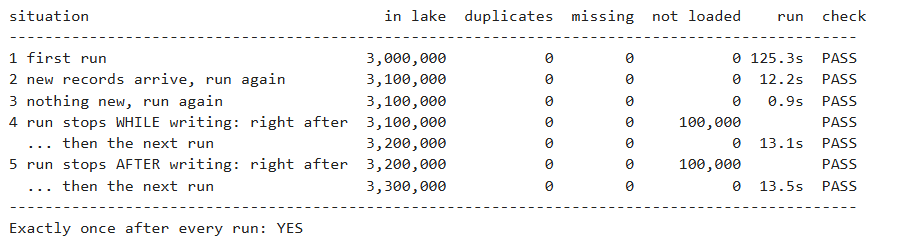
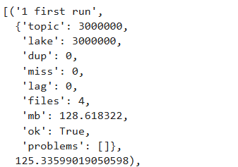
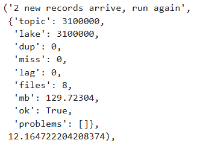
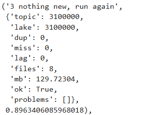
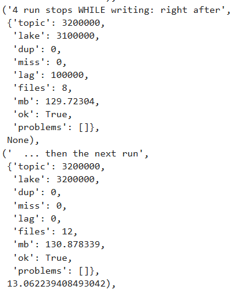
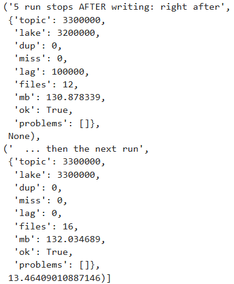

# Exercise 7: From the log to the lake

A batch job copies the Kafka topic `logs` into a data lake (Parquet files),
every few minutes. Each run **reads** the new records, **writes** them into
the lake, and **remembers** where it stopped.

**Your task:** choose how the job remembers where it stopped, implement it in
about five lines, and show that no record is ever missing or copied twice,
even if a run stops halfway.

## Part 0: setup

Stop the containers of Exercise 6 (`docker compose down -v` in that folder).
Then download the images (~5 GB, you need them next week too), start them,
and fill the topic with 2,000,000 log records:

```bash
docker compose --profile generator pull
docker compose up -d
```

Create a kafka topic with 4 partitions:
```bash
docker exec kafka kafka-topics.sh --bootstrap-server localhost:9092 --create --topic logs --partitions 4 --replication-factor 1

docker compose run --rm generator
```

Open <http://localhost:8888/?token=lab> and the notebook
`work/exercise7.ipynb`.

## Part 1 

1. **Run the example** (section 1 of the notebook). It copies the whole topic
   twice. Why does the checker fail?
> **ANSWER**: It uses `read_new(None)`, so the job doesn't remember the last 
> record of each reading, and it starts from the beginning every time.


2. **Choose an architecture:**
   - **A — State file:** the job saves where it stopped in a small file
     after writing.
   - **B — The lake is the truth:** the job finds where it stopped in the
     lake itself; it writes each run to a staging folder first, then moves
     it into the lake in one step.
   - **C — Remove duplicates when reading:** the lake may contain duplicates;
     readers use a view that keeps each record once.
> **ANSWER**: 
> - **Option A (state file)**: writing the data and saving the state are two separate
> steps. If it crashes after writing, before saving the state we'll have duplicated
> records. If it saves the state first and crashes while writing, they'll be missing
> records.
> 
> - **Option B (the lake is the truth)**: Every record in the lake carries its Kafka 
> partition and offset. The position of the job is derived from the data, so we 
> don't need to store anything in a small file. And it writes each run to a 
> staging folder, when the run is completed, it moves it into the lake in one step.
> That means, if something goes wrong, and it crashes during the writing on the
> staging folder, nothing is lost or duplicated. The half-written files stay in 
> staging, the lake and its position don't change, and the next run simply does the
> same batch from scratch again.
> 
> - **Option C (remove duplicates when reading)**: It accepts duplicates and removes them
> at query time, but it moves the problem to every reader and wastes storage.
> 
> For these reasons, I choose the second architecture (B: the lake is the truth).


3. **Implement** `run_once()` (section 3 of the notebook) with the building
   blocks listed there.
> **ANSWER**: 
> ```python
> def run_once():
>   # 1. where did the last run stop?
>   ## lake_position() -> where the last run stopped, read from the lake itself (None if the lake is empty)
>   start = lake_position()
>
>   # 2. read what is new
>   new = read_new(start)
> 
>   # 3. write it
>   ## writes them as Parquet into a new run folder inside STAGING
>   run = write_files(new, STAGING)
>   ## moves a finished run folder from STAGING into the lake
>   publish(run)
> 
>   # 4. remember where you stopped (if your architecture needs it)
>   ## We don't need it, because option B derives the position 
>   ## of the job from the data
> ```


4. **Check** it (section 4): `check_all(run_once)` tests five situations,
   including runs that stop halfway. For C: `check_all(run_once, lake_sql=DEDUP_SQL)`.
> **ANSWER**: 
> 
> 
> 
> Every run passes with 0 duplicates and missing records in all five situations.


> **Run 1**: A first run
> 
> The lake is empty, so `lake_position()` is `None`. The whole topic is read,
> written to staging and published.
> 
> 
> 
> It takes so long because it reads the whole topic. In the first run, it 
> publishes 3,000,000 records (in the lake).

> **Run 2**: New records
> 
> `lake_position()` returns the last offset per partition. Only the records
> after it are read and published.
> 
> 
> 
> The following runs, as this one, only read the 100,000 new records, 
> because the position comes from the lake. So we obtain 100,000 more records.


> **Run 3**: Nothing new
> 
> `read_new()` returns 0 records. Nothing is added, so no duplicates.
> 
> 
> 
> It's the shortest run, as it doesn't add or publish anything.


> **Run 4**: A run that stops while writing
> 
> The records are being written into the STAGING folder, but the run stops.
> So we have an incomplete folder and nothing is written into the LAKE.
> The next run asks the lake, gets the same position as before and writes
> the same records again, exactly once.
> 
> 
> 
> After the crash the lake is unchanged, and the 100,000 new records are
> simply not loaded (we can see it on the table). The next run reads those 
> records again and publishes them once, without duplicates.

> **Run 5**: A run that stops after writing
> 
> All the data is now written in STAGING, but run stops. So the lake
> position doesn't move because nothing has been published. The next run 
> redoes the batch and publishes it once, the same as in the previous run.
> 
> 
>
> After the crash the lake is unchanged (3,200,000 records) and the 100,000
> new records aren't loaded. The next run loads them (3,300,000
> records), without duplicates or missing records.
>
> The result is the same as in run 4, but this case tests something
> different. Run 4 shows that a half-written run is never visible in the
> lake. Run 5 shows that the position only advances when the run is
> published, in one atomic step, so there is no moment when the data is
> visible but the position has not moved (which would create duplicates).


The building blocks use Spark. You may use another technology if it meets
the same goal: no record missing, none twice, and the lake readable with
DuckDB (the checker in `tools/check_lake.py` works with any technology).

In `Exc_7/solution/README.md`, explain:

1. **Your decision:** which architecture and why
2. **Explain your result**
3. **The output of `check_all`.**

Add your notebook as `Exc_7/solution/exercise7.ipynb`. Be ready to present
your solution in about 5 minutes in the next exercise session (26.11.2026).

## Submission

Push `Exc_7/solution/` to your fork and add the link to the Moodle
submission. **Deadline: 25.11.2026, 18:00.**

<details>
<summary>Troubleshooting</summary>

- **Container name already in use / port already allocated:** the containers
  of Exercise 5 or 6 are still running: `docker compose down -v` in that
  folder.
- **The topic has 1 partition:** the generator ran before the topic was
  created. Delete it
  (`docker exec kafka kafka-topics.sh --bootstrap-server localhost:9092 --delete --topic logs`)
  and repeat Part 0.
- **`No module named ...` or `Failed to find data source: kafka`:** check
  your internet connection, restart the kernel and run the cells again.
- **Clean up:** `docker compose down` removes the containers and the topic.

</details>
